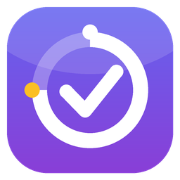
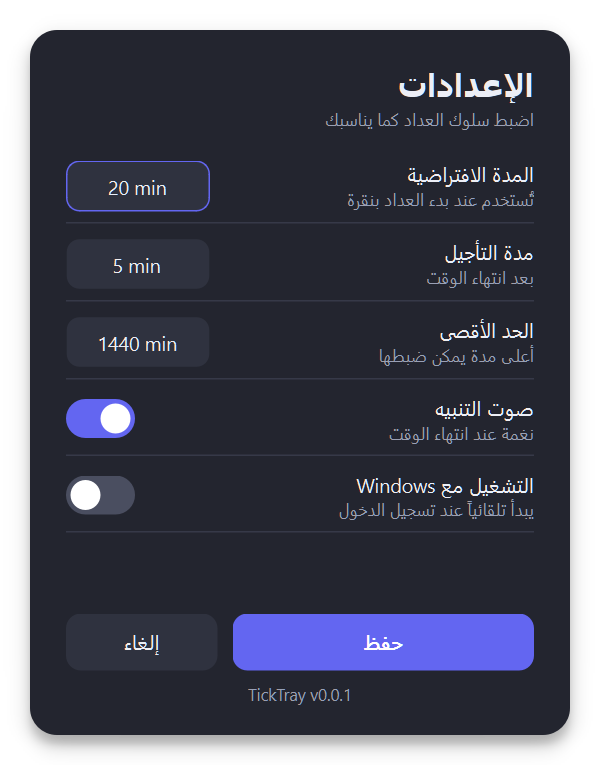

<div align="center">



# TickTray ⏱

**A tiny countdown timer that lives in your Windows system tray: one click to start, and it alerts you when time is up.**

   

**English** · [العربية](#العربية)

[**⬇ Download TickTray.exe**](https://github.com/alimwork85-web/TickTray/releases/latest/download/TickTray.exe)



</div>

---

# English

## Goal

Sometimes all you need is a quick timer: coffee on the stove, a break between work sessions, a reminder in 20 minutes. No heavy app, no window taking over your screen.
**TickTray** stays quietly in the system tray, shows the remaining time when you hover over its icon, and alerts you with a sound and a notification when time is up.

## Features

- 🖱️ **One click**: left-click the tray icon to start the timer; click again to pause or resume.
- 🔵 **Live icon**: the icon shows the minutes left (or hours, e.g. `2h`, past 99 minutes) inside a ring that shrinks as time runs out, so you see it without hovering.
- 🔢 **Digits only**: hover to see the countdown, e.g. `19:36`, always in Western digits (0-9).
- ⚡ **Quick times**: 5 / 10 / 25 / 45 minutes, or a custom time that the app remembers.
- 😴 **Snooze**: click the notification (or pick "Snooze" from the menu) when time is up.
- 🌐 **Arabic and English**: switch the language from Settings (menus, notifications and windows, right-to-left for Arabic). The first run follows your Windows language.
- ⚙️ **Modern settings**: animated window with light and dark themes; configure default duration, snooze length, maximum duration, alert sound and language.
- 🚀 **Start with Windows**: optional auto-start at sign-in.
- 🛡️ **Single instance**: running it twice never creates a second icon.
- 🪶 **Lighter EXE**: unused Qt modules are left out of the build (about 26 MB instead of 38 MB).
- ⏳ **Accurate**: time is computed from a fixed deadline, so it does not drift over long durations.

## Download and run

1. Go to [**Releases**](../../releases) and download `TickTray.exe`.
2. Run it directly: no installer, no admin rights. The icon appears in the system tray (it may be behind the ^ arrow).
3. Right-click the icon to open the menu.

> **Note:** the file is not code-signed, so Windows SmartScreen may show a warning on first run. Click "More info", then "Run anyway".

Settings are stored in `%APPDATA%\TickTray\config.json`, and the error log in `TickTray.log` next to it.

## Run from source

```bash
python -m venv venv
venv\Scripts\pip install -r requirements.txt
venv\Scripts\python main.py
```

Build the EXE (the file version shown in Windows properties comes from `version.py`):

```bash
venv\Scripts\python tools\make_version_info.py
venv\Scripts\pyinstaller TickTray.spec
```

The output is `dist\TickTray.exe`. The icon is drawn entirely in code by `tools/make_icon.py` (requires Pillow).

## Project layout

| File | Role |
|---|---|
| `main.py` | Tray icon, menu and timer |
| `config.py` | Loading, validating and saving settings; start with Windows |
| `i18n.py` | Arabic / English strings |
| `settings_dialog.py` | Settings window, animation and toggle switches |
| `tray_icon.py` | Live tray icon rendering |
| `version.py` | Single source of the version number |
| `tools/` | Icon generator and version-resource generator |

## License

Released under the [MIT License](LICENSE): free to use, modify and share.

## Tags

`#TickTray` `#Timer` `#CountdownTimer` `#SystemTray` `#Windows` `#Windows11` `#PyQt6` `#Python` `#Productivity` `#Pomodoro` `#Arabic` `#RTL` `#Bilingual`

---

<div dir="rtl">

# العربية

## الهدف

أحياناً كل ما تحتاجه عدّاد سريع: قهوة على النار، استراحة بين جلسات العمل، أو تذكير بعد 20 دقيقة. لا تحتاج تطبيقاً ثقيلاً ولا نافذة تشغل الشاشة.
**TickTray** يبقى هادئاً في صينية النظام، ويُظهر لك الوقت المتبقي بمجرد أن تمرّ بالفأرة على أيقونته، ثم يُنبّهك بصوت وإشعار عند الانتهاء.

## المميزات

- 🖱️ **نقرة واحدة**: نقرة يسار على الأيقونة تبدأ العداد، ونقرة أخرى توقفه مؤقتاً أو تستأنفه.
- 🔵 **أيقونة حيّة**: تعرض الأيقونة نفسها الدقائق المتبقية (أو الساعات مثل `2h` إذا تجاوزت 99 دقيقة) داخل حلقة تتناقص مع الوقت، فتراها دون المرور بالفأرة.
- 🔢 **أرقام فقط**: عند مرور الفأرة يظهر العدّ التنازلي مثل `19:36`، وبأرقام غربية (0-9) دائماً.
- ⚡ **أوقات سريعة**: 5 / 10 / 25 / 45 دقيقة، أو وقت مخصص يتذكّره البرنامج.
- 😴 **تأجيل**: عند انتهاء الوقت انقر الإشعار (أو اختر «تأجيل» من القائمة) لتأجيل التنبيه.
- 🌐 **عربي وإنجليزي**: بدّل اللغة من الإعدادات (القوائم والإشعارات والنوافذ، ومن اليمين إلى اليسار في العربية). في أول تشغيل يتبع لغة Windows لديك.
- ⚙️ **إعدادات عصرية**: نافذة بحركة انسيابية، تدعم الوضعين الفاتح والداكن، وتتحكم في المدة الافتراضية ومدة التأجيل والحد الأقصى وصوت التنبيه واللغة.
- 🚀 **تشغيل مع Windows**: خيار لبدء البرنامج تلقائياً عند تسجيل الدخول.
- 🛡️ **نسخة واحدة فقط**: لا تتكرر الأيقونة إن شغّلته مرتين.
- 🪶 **ملف أخف**: تُستبعد وحدات Qt غير المستخدمة من البناء (نحو 26 MB بدل 38 MB).
- ⏳ **دقيق**: يحسب الوقت من موعد انتهاء ثابت، فلا يتراكم عليه انحراف مع طول المدة.

## التحميل والتشغيل

1. افتح صفحة [**Releases**](../../releases) وحمّل `TickTray.exe`.
2. شغّله مباشرة، فلا يحتاج تثبيتاً ولا صلاحيات مدير. ستجد الأيقونة في صينية النظام (قد تكون خلف السهم ^).
3. انقر بيمين الفأرة على الأيقونة لفتح القائمة.

> **تنبيه:** الملف غير موقَّع رقمياً، لذلك قد تعرض Windows SmartScreen تحذيراً عند أول تشغيل. اختر «مزيد من المعلومات» ثم «تشغيل على أي حال».

تُحفظ إعداداتك في `%APPDATA%\TickTray\config.json`، وسجل الأخطاء في `TickTray.log` بجانبه.

## التشغيل من المصدر

الأوامر نفسها الموضحة في القسم الإنجليزي أعلاه (`pip install -r requirements.txt` ثم `python main.py`). وللبناء: `python tools\make_version_info.py` ثم `pyinstaller TickTray.spec`. الناتج في `dist\TickTray.exe`، ورقم الإصدار الظاهر في خصائص الملف مصدره `version.py`. وتُرسم الأيقونة بالكامل من الكود عبر `tools/make_icon.py` (يحتاج Pillow).

## الترخيص

مرخّص بموجب [MIT](LICENSE): يمكنك استخدامه وتعديله ومشاركته بحرية.

## الوسوم

`#TickTray` `#Timer` `#CountdownTimer` `#SystemTray` `#Windows` `#Windows11` `#PyQt6` `#Python` `#Productivity` `#Pomodoro` `#Arabic` `#RTL` `#عداد` `#مؤقت` `#الإنتاجية` `#أدوات_ويندوز`

</div>
